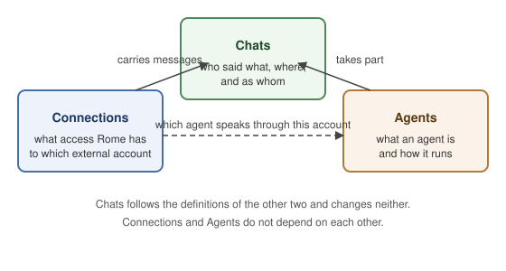

# Chats, accounts and agents share one language, written with the guardian

- **Status**: Accepted
- **Date**: 2026-10-21
- **Concepts**: [messaging](../concepts/messaging.md), [people](../concepts/people.md), [agents](../concepts/agents.md)
- **Architecture**: [Channels](../architecture/channels.md)

## Context

Rome lets a guardian link agents to accounts on chat platforms, a feature the product calls envoy. The code, the docs and the dashboard grew their own words for the pieces of it: channel, connection, bot, linked agent, conversation, routing. Several meant the same thing, and some meant two things. A guardian talking to a contributor, or to a coding agent, had to define the words again each time, and a design that started from the code inherited its accidents.

The guardian who owns the product is the domain expert here. This record holds the language agreed with them, in their words, so that any contributor or coding agent starts from it rather than from the code. The method is Domain-Driven Design: one vocabulary split into contexts that each answer one question, every word with one meaning, and the code carrying the same words.

The record states the model. Where the code does not yet match it, [Consequences](#consequences) says so. The invariants the code already holds live in the concepts entries this record links, which stay the home of what is true now.

## Decision

The domain is three contexts. **Chats** answers who said what, where, and as whom. **Connections** answers what access Rome has to which external account. **Agents** answers what an agent is and how it runs, and is reused as it stands. Chats follows the definitions of the other two and changes neither. Connections and Agents do not depend on each other.

### Chats

- **Chat.** A place where people and agents talk: a group, a direct message, the chat built into the dashboard. The code and the dashboard call it a conversation, a deprecated alias for the same thing. A group is named by the platform's own id for it, so one group is one chat however many of Rome's accounts are in it. A direct message is named by its two ends, the other account and the one of Rome's accounts it writes to, so a colleague writing to Sales and to Support is two chats, whatever id the platform gives the two. A chat starts existing in Rome when its first message reaches Rome through one of Rome's accounts. Its history belongs to the chat and goes when the last of Rome's accounts leaves it, not before.
- **Thread.** A chat inside a chat, started from one of its messages. A thread is not a chat of its own: its messages are the parent's, marked as said in that thread. It has its own participants, those the platform lists in it. Everyone in the parent whom the platform lets see a thread sees it, agents included, and can write in it. A thread the platform hides from some members, such as a private thread, is hidden from them in Rome too. The parent's reply rule applies in its threads.
- **Participant.** Someone in a chat: a person or an agent. The participants are everyone the platform says is a member.
- **Agent, as a participant.** When an agent speaks through its own account, the agent is the participant. When an agent answers from the guardian's account, the guardian is the participant and the agent answers on their behalf. An agent sees every message its account receives, mentioned or not. Whether it answers is the chat's reply rule for that account. How an agent remembers what it sees belongs to the Agents context. This context describes participants and messages and says nothing about memory.
- **Reply rule.** A setting on a chat, for each of Rome's accounts in it, saying when that account's agent answers: everything, or only when mentioned. It decides answering only. What the agent sees is whatever the platform delivers.
- **Message.** One thing a participant said. Every message goes one way, to Rome or from Rome. A delegate's reply is recorded as said by the agent on the guardian's behalf, under the guardian's account.
- **Platform.** Somewhere chats live. Two platforms are the same when one account can log in to both: Feishu and Lark are two, a Telegram bot and a signed-in Telegram user are one.
- **Account.** A participant's identity on a platform, named by the platform and the platform's own id for it. A person's identity and an agent's identity are the same kind of thing, so what a platform calls a bot is an account, and these docs say account. Most accounts in a chat are other people's. An account Rome holds a connection to has at most one agent speaking through it, the same in every chat, and may have none: then Rome does not listen to that account at all. The guardian **links** an agent to such an account, **switches** it in one step, or **unlinks** it. Connecting an account and linking an agent are two separate operations, so every connected account passes through the state of having no agent, and Rome never picks an agent for it.
- **Own account** and **delegate** are the two kinds of link: an agent linked to an account that is its own, so it speaks as that account, or an agent linked to the guardian's own account, so it answers on their behalf. The product shows which kind an account has.
- **Envoy** is the feature's name for linking agents to accounts. It is not a thing in the model, and the dashboard's use of it as a page name is branding.

### Connections

- **Connection.** Rome's access to an external account: what the guardian granted so Rome can act or talk as that account. The guardian **connects** an account to give Rome access and **disconnects** it to take the access away. There is no replacing one account with another: disconnect one, connect the other, and the new one starts fresh, with no history. A chat's history is the chat's, so disconnecting an account removes only the messages no other of Rome's accounts in that chat holds. A connection used in chats is how an account's messages reach Rome and how its agent's replies go back, and there is no separate word for that plumbing. A connection used outside chats, such as GitHub, has no agent bonded to it.
- **Grant.** One act of giving Rome access, and what it allows. Grants are outside envoy and keep their current contracts ([ADR](channels-and-connectors-are-one-connection.md)).

### Agents

- **Agent.** A named Rome agent ([concept](../concepts/agents.md)). Nothing here changes what an agent is.

**Channel** is not a word of this language. It is the code's name for the layer that carries an account's messages ([Channels](../architecture/channels.md)), a technical word like repository, and the guardian never meets it.

## Alternatives

- **Channel as a concept the guardian meets, with its own identity and lifetime.** Rejected because a channel is one to one with a connected account, so the two words name one thing and the guardian only ever sees the account. Its jobs went to account, connection and chat.
- **A per-chat choice of agent that overrides the account's agent.** Rejected because an account named "Sales agent" has to be the sales agent wherever it appears, and a per-chat override breaks that intuition. The override still exists in the code and is removed with a migration ([Consequences](#consequences)).
- **At most one account per agent per platform.** Rejected because a guardian with two Feishu accounts for one agent is an ordinary case, and the rule forced a "move the link" behaviour nobody asked for.
- **The next connection of a service takes over the disconnected account's name, chats and history.** Rejected because a new account is a new participant, and inheriting another account's history misattributes what was said. The disconnected account's record is deleted, with the messages that reached Rome only through it: a chat another of Rome's accounts is still in keeps its history, as the chat rule says. A retired-but-kept record was considered and rejected, since the guardian has no use for a record nothing reaches.
- **Linking a service's first account to main automatically.** Rejected because connecting and linking are two operations and cannot be made one, so an intermediate state with no agent exists anyway, and an agent the guardian did not pick is confusing. Where the product asks the guardian to pick is a design choice, not a model rule.
- **A thread as a chat of its own.** Rejected because people do not think of a thread as a chat: it is a side chat inside one, seen by everyone in it. Letting the thread model decide the agent's memory boundary was rejected with it. Memory is the agent's own decision.
- **Keeping "bot", "linked agent" and "unlink" alongside the new words.** "Bot" and "linked agent" as a noun were rejected because a person's identity and an agent's identity on a platform are the same kind of thing, and one name per thing is the writing rule. "Unlink" stays: it is the verb for taking an agent off an account.
- **An anti-corruption layer translating between the old vocabulary and the new.** Rejected because that layer is for a context one cannot change, and Rome is one codebase its owners can change. It would add a second vocabulary to keep in step with the first. The code is refactored instead, each change landing as add beside, switch callers, remove.

## Consequences

- Code, UI copy and docs use the words above and no synonyms. A new name for one of these things goes through [concepts](../authoring/concepts.md) first.
- A change to one of these rules changes this record, and the concepts entry that holds the invariant, in the same PR as the code.
- Modules and types in the code take the context and word names, so a reader of the code reads the model.
- Implemented on `main` as of this record's date:
  - an account that takes an agent exists only while connected and is never reclaimed. Email and WhatsApp accounts, which take no agent, keep their record across a reconnect
  - Rome listens to an account that takes an agent only while one is linked. An account that takes no agent is always listened to
  - any number of accounts per agent per platform, and one agent per account in storage
  - Feishu and Lark as two platforms
  - the words account, agent, connect, disconnect, link, switch and unlink in the dashboard and docs
- Diffs still owed to the model, each a change of its own:
  - chat replaces conversation in the dashboard, the docs and the code
  - the per-chat agent override is removed with a migration
  - the own-account and delegate kinds are stored and shown
  - one group is one chat across all of Rome's accounts in it
  - a Feishu person is one account across all of Rome's Feishu accounts, by the tenant-wide id
  - participants are the platform's member list
  - adapters deliver every message, and the reply rule is applied after delivery
  - a thread's messages are the parent chat's, marked by thread
  - a disconnected account's record is deleted, with the messages only it carried
  - no automatic link to main
- The envoy check that validates outgoing messages ([agent hierarchy](../concepts/agents.md#agent-hierarchy)) keeps its name. It is unrelated to the feature and the name does no harm.
