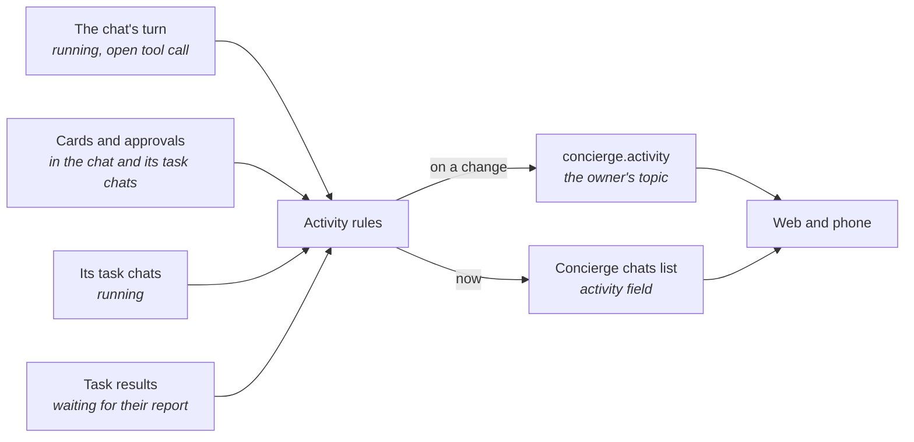

# Concierge activity

What a [Concierge chat](../domains/chats.md#concierge-chat) is doing right now, as its header says it, and how that reaches the clients. The Concierge itself is in [Concierge](concierge.md).

## Flow

## Invariants

- **Rome derives a Concierge chat's activity from facts it holds,** never from a state the Concierge writes: whether a card or an approval waits on the owner in the chat or in a [task chat](../domains/chats.md#task-chat) it started, whether the chat's own turn runs and which tool call it is in, whether a task result waits for the turn that reports it, and which of its task chats run.
- **One order decides it everywhere:** something waiting on the owner, then the chat's own turn, then a result about to be reported, then its running task chats, else idle. A client shows the activity it is told and never derives one of its own.
- **Only a task still going on counts:** its row is open, its task chat runs now, or its task chat was active after the row finished, as when the Concierge resumes it. A card or an approval left in the chat of a task that is done or dropped never waits on the owner.
- **A task result counts from the moment the task chat ends until the turn that reports it ends,** so the chat never reads as idle between the two.
- **A named tool call stays the activity for at least 1.5 s** before plain work, running task chats or idle takes its place. Something waiting on the owner and another named tool replace it at once.
- **Idle is told only once it has lasted 1 s,** since one fact often ends a moment before the next begins. Every other change is told at once.
- **A quiet turn, one the owner is not meant to see, counts as work only once it says something,** as the transcript shows it.
- **A turn running never answers what waits on the owner.** A card or an approval waits until it is answered or resolved, whatever runs meanwhile: an agent works on with an approval pending, and a background turn runs past an open card.
- **No activity stays stale.** Every chat whose activity is not idle has its facts read again at least every 30 s, so a fact that changes without telling still shows, and a busy chat that is archived or deleted is told idle.
- **The activity is said as a kind and its parameters, never as text.** Each client words it in its own language, so a server change never changes a client's copy.
- **Tools and kinds are only ever added, and a client reads one it does not know without failing:** an unknown tool is plain work, and an unknown kind reads as idle, over whatever the chat showed before. A client never drops an event or fails to load the chats list over a value it does not know.
- **It reaches the chat's owner only,** on the owner's own `concierge.activity` live-events topic, and only when it changes. Like the chat, it does not exist for anyone else, the guardian included.
- **A client that connects or reconnects starts from where each chat stands now:** a new subscription first tells every one of the owner's Concierge chats, and the Concierge chats list carries each chat's current activity. Both are additions, so a client from before them keeps working.
