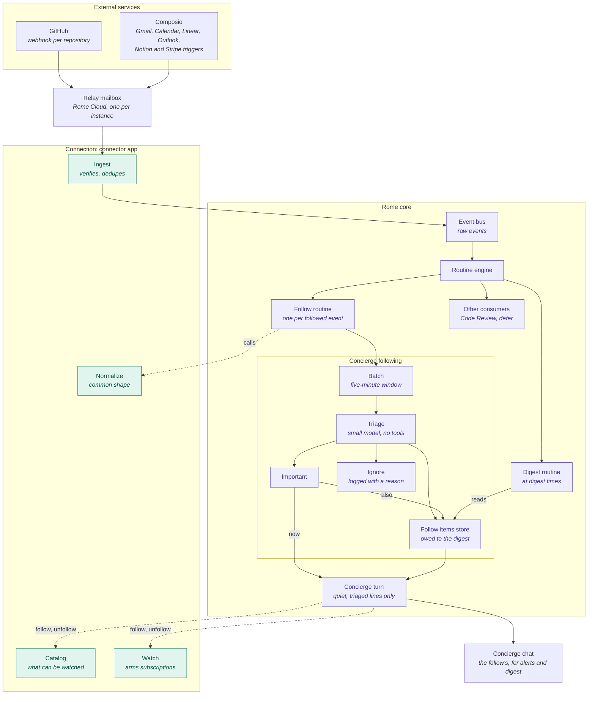

# Concierge Following

How an event from a service the guardian follows reaches the Concierge, and the rules that keep every service difference in the [connection](../domains/connections.md#watch) and every message in the Concierge's own voice.

## Flow

Solid lines carry an event. Dashed lines are calls to the connection: to normalize, to list what can be followed, and to subscribe.

## Invariants

### The connection owns every service difference

- **Core never names a service.** A service's events, how to subscribe, what a raw event means and how to reach the account come from the connection's watch provider. Following, triage and delivery never branch on a service, and a new service is one more adapter in the connection's registry. [ADR](../adrs/watch-specifics-in-the-connection.md)
- **Core finds watch providers from what apps declare, never by app name.** An app that declares none is not followed, and no app can declare another app's actions as its provider.
- **The event bus carries the raw event.** The connection normalizes it when a follow routine asks, with that follow's account and kinds. Other consumers, such as Code Review and `defer`, read it unchanged. A Composio event alone adds its delivery id, the same each time that delivery is published and different for two occurrences with the same fields.
- **An event that names only ids is read in full by the connection,** such as an Outlook message or a Notion comment, through the connected account. A failed read throws, the routine retries the event once 30 seconds later, and a second failure is logged and not delivered.
- **The connection drops only what is not an event for the follower:** spam, trash, a kind the follow has off, a repeat. It describes each event in generic fields (`byYou`, `addressedTo`) and labels, and never judges whether it matters. [ADR](../adrs/model-triage-over-code-filters.md)
- **Nothing after the connection drops an event in code.** What the guardian did, who sent it and how it is addressed reach triage as fields. A follow's options are structured values the catalog declares, reaching triage as the guardian's wishes in words from the catalog's labels: guidance, never filters. Its free-text `preference` covers what no option does.

### Triage decides importance, and the Concierge decides what to say

- **Triage reads the normalized event with catalog kind labels, the follow's options as words, its preference and what was told recently.** It has no tools and answers important, digest or ignore per event. Its prompt states goals and names no service, labels are descriptions it weighs, not rules, and when unsure it answers digest.
- **Triage never decides delivery.** An important item reaches the Concierge promptly, in the [Concierge chat](concierge.md) its follow reports to, and the Concierge decides whether to tell the guardian now. The digest of a follow goes to the same chat.
- **Every message to the guardian is a Concierge turn.** Following never posts into a chat itself.
- **A digest runs at every digest time, and each chat with items gets its own.** Every important and digest item goes into the next digest of its chat, told or not, important items first. A chat that is archived or gone hands its items to the main chat. A chat with nothing new gets no digest, and the main chat gets an empty one when nothing is new anywhere. The Concierge tells what is new: an item it already told is not news.
- **A failure loses no event silently.** A failed triage run's events go to the digest. A failed batch is tried again with later batches and dropped with a warning only after three tries. A failed important turn leaves its items owed and is tried again. A failed digest turn leaves only its chat's items owed for the next digest.

### Limits apply to Concierge turns, not to events

- **Important turns have an hourly cap,** past which important items wait for the digest. Quiet hours hold important turns until the window ends.
- **The guardian changes following only through the Concierge in chat.** Follows, kinds, options, preferences, digest times and quiet hours have no other way to change.

### Text from outside Rome is data

- **The Concierge never sees a raw payload,** only the lines triage wrote, with their links, in a fence marked untrusted. Triage reads only the normalized event, as data.

### Every decision leaves a record the guardian can read, and no record keeps outside content it does not need

- **Each triage run is recorded in one "Concierge triage" session,** with its input and every decision. A batch runs fresh, so one batch's events never feed the next.
- **A following turn's input stays in its trace,** labelled, so the Concierge's session shows why it spoke or stayed silent. Other system turns keep no such block, and none of it appears in the chat.
- **A follow routine's run history keeps no event payload,** only its size. The action still gets the whole event.
- **An ignored event leaves one log line** with its source, kind and reason, never its content.

### Subscriptions at the source are shared

- **Unfollowing removes the Concierge's routines and leaves the subscription at the source.** One subscription, such as a repository's webhook, may serve several consumers, and the connection does not count them yet, so nothing releases one ([#1658](https://github.com/rome-os/rome/issues/1658)).
- **The Concierge resubscribes its follows after boot and at a fixed interval,** restoring one another consumer removed.
- **A Rome uses one pinned Composio project,** which its Composio connections, triggers and webhook all address. The account's default project never moves it. A project has one webhook, so two Romes on one account both get events only when each pins its own. A Rome whose project delivers to another Rome reports its Composio sources not ready, with the reason, until it takes the webhook back or picks its own project ([#1719](https://github.com/rome-os/rome/issues/1719)).
- **A follow whose subscription at the source is gone says so.** The connection names each kind missing one, and a follow with such a kind on reports itself unavailable with that reason until followed again. Reading this never arms a subscription.

### The Concierge reaches following through actions

- **Every following operation is an action the Concierge calls through `execute_action`, checked against its live allow-list.** A Concierge thread keeps the tools it started with, so a new tool would not reach it ([#1739](https://github.com/rome-os/rome/issues/1739)).
