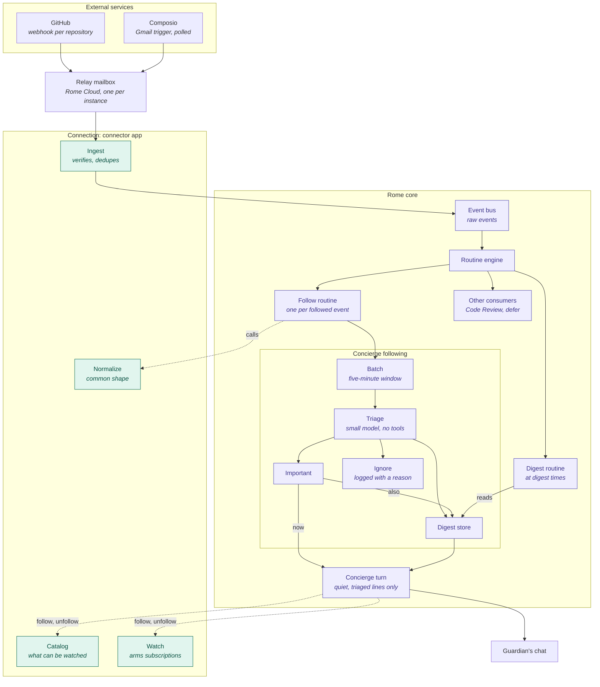

# Concierge Following

How an event from a service the guardian follows reaches the Concierge, and the rules that keep every service difference in the [connection](../domains/connections.md#watch) and every message in the Concierge's own voice.

## Flow

Solid lines carry an event. Dashed lines are calls: the follow routine asks the connection to normalize, and the Concierge asks it what can be followed and to subscribe.

## Invariants

### The connection owns every service difference

- **Core never names a service.** Which events a service has, how to subscribe to them, what a raw event means, and how to reach the account all come from the connection's watch provider. Following, triage, delivery and the Following panel never branch on a service. A new service changes only its connection. [ADR](../adrs/watch-specifics-in-the-connection.md)
- **Core finds watch providers from what apps declare, never by app name.** An app that declares no watch provider is not followed, and an app cannot declare another app's actions as its provider.
- **The event bus carries the raw event.** The connection normalizes an event when a follow routine asks, with that follow's account and kinds. Other consumers of the same event, such as Code Review and `defer`, read it unchanged.
- **The connection drops only what is not an event for the follower:** spam, trash, a kind the follow has off, a repeat. Whether an event matters is never decided by a rule in the connection or in core. [ADR](../adrs/model-triage-over-code-filters.md)

### Triage decides importance, and the Concierge decides what to say

- **Triage reads the normalized event, the follow's preference in the guardian's words, and what was told recently.** It has no tools and answers important, digest or ignore for each event.
- **Triage never decides delivery.** An important item reaches the Concierge promptly, and the Concierge decides whether to tell the guardian now or stay silent.
- **Every message to the guardian is a Concierge turn.** No part of following posts into the chat by itself.
- **Every important and digest item goes into the next digest, whether or not the Concierge told it.** Important items lead the digest. The Concierge gives an item already told one short line.
- **A failure loses no event silently.** A triage run that fails sends its events to the digest. A batch that fails is tried again with later batches and is dropped with a warning only after three tries. An important turn that fails leaves its items owed and is tried again.

### Limits apply to Concierge turns, not to events

- **Important turns have an hourly cap.** Past it, important items wait for the digest. Quiet hours hold important turns until the window ends.
- **The guardian's words change the rules only through the Concierge.** Digest times, quiet hours, kinds, options and preferences change in chat. The Following panel shows the follows and changes nothing.

### Text from outside Rome is data

- **The Concierge never sees a raw payload.** It reads the lines triage wrote, with their links, inside a fence marked untrusted. Triage reads only the normalized event, as data in its prompt.

### Subscriptions at the source are shared

- **Unfollowing removes the Concierge's routines and leaves the subscription at the source in place.** One subscription, such as a repository's webhook, may serve several consumers. The connection does not yet count who uses a subscription, so nothing releases one ([#1658](https://github.com/rome-os/rome/issues/1658)).
- **The Concierge subscribes its follows again after boot and at a fixed interval,** so a subscription another consumer removed comes back.

### The Concierge reaches following through actions

- **Every following operation is an action the Concierge calls through `execute_action`, checked against its live allow-list.** A Concierge thread keeps the tools it started with, so a new tool would not reach existing threads.
