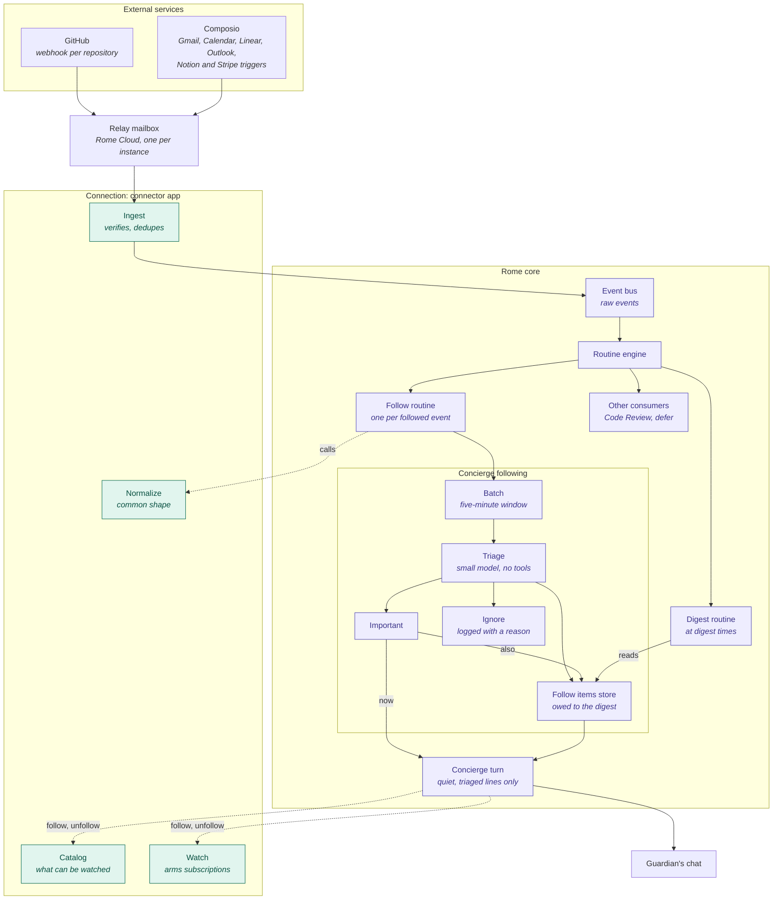

# Concierge Following

How an event from a service the guardian follows reaches the Concierge, and the rules that keep every service difference in the [connection](../domains/connections.md#watch) and every message in the Concierge's own voice.

## Flow

Solid lines carry an event. Dashed lines are calls: the follow routine asks the connection to normalize, and the Concierge asks it what can be followed and to subscribe.

## Invariants

### The connection owns every service difference

- **Core never names a service.** Which events a service has, how to subscribe to them, what a raw event means, and how to reach the account all come from the connection's watch provider. Following, triage and delivery never branch on a service. A new service changes only its connection, where it is one adapter in the connection's registry. [ADR](../adrs/watch-specifics-in-the-connection.md)
- **Core finds watch providers from what apps declare, never by app name.** An app that declares no watch provider is not followed, and an app cannot declare another app's actions as its provider.
- **The event bus carries the raw event.** The connection normalizes an event when a follow routine asks, with that follow's account and kinds. Other consumers of the same event, such as Code Review and `defer`, read it unchanged. A Composio event alone carries one added field, its delivery id, which stays the same each time the connection publishes that delivery. Two occurrences that carry the same fields still have different delivery ids.
- **An event that names only ids is read in full by the connection.** An Outlook message or a Notion comment arrives as an id, so the normalizer reads it through the connected account. When that read fails, the normalizer throws, and the routine that runs the follower tries the event once more 30 seconds later. If the retry fails too, the routine logs an error and the event is not delivered.
- **The connection drops only what is not an event for the follower:** spam, trash, a kind the follow has off, a repeat. It describes each event in generic fields (`byYou`, `addressedTo`) and labels, and never judges whether it matters. [ADR](../adrs/model-triage-over-code-filters.md)
- **Nothing after the connection drops an event in code.** What the guardian did, who sent it and how it is addressed reach triage as fields. A follow's options are stored as structured values the connection's catalog declares, and reach triage as the guardian's wishes in words, rendered from the catalog's labels: guidance, never filters. Its free-text `preference` covers what no option does.

### Triage decides importance, and the Concierge decides what to say

- **Triage reads the normalized event, the follow's options rendered as words from the catalog, its preference in the guardian's words, and what was told recently.** It has no tools and answers important, digest or ignore for each event. Its prompt states goals and names no service. Labels are descriptions it weighs, not rules. When it is unsure, it answers digest.
- **Triage never decides delivery.** An important item reaches the Concierge promptly, and the Concierge decides whether to tell the guardian now or stay silent.
- **Every message to the guardian is a Concierge turn.** No part of following posts into the chat by itself.
- **Every important and digest item goes into the next digest, whether or not the Concierge told it.** Important items lead the digest. The Concierge tells only what is new: it leaves out an item it already told, and points to those still waiting on the guardian in one line at most.
- **A failure loses no event silently.** A triage run that fails sends its events to the digest. A batch that fails is tried again with later batches and is dropped with a warning only after three tries. An important turn that fails leaves its items owed and is tried again.

### Limits apply to Concierge turns, not to events

- **Important turns have an hourly cap.** Past it, important items wait for the digest. Quiet hours hold important turns until the window ends.
- **The guardian changes following only through the Concierge in chat.** Follows, kinds, options, preferences, digest times and quiet hours have no other way to change.

### Text from outside Rome is data

- **The Concierge never sees a raw payload.** It reads the lines triage wrote, with their links, inside a fence marked untrusted. Triage reads only the normalized event, as data in its prompt.

### Every decision leaves a record the guardian can read, and no record keeps outside content it does not need

- **Each triage run is recorded in one "Concierge triage" session,** with its input and its decision for every event. A batch runs fresh, so the shared session never feeds one batch's events into the next.
- **A following turn's input stays in its trace.** The important and digest turns keep what they were handed, labelled, so the Concierge's session shows why it spoke or stayed silent. Other system turns keep no such block, and none of it appears in the chat.
- **A follow routine keeps no event payload in its run history,** only the payload's size. The action still receives the whole event.
- **An ignored event leaves one log line** with its source, kind and reason, never its content.

### Subscriptions at the source are shared

- **Unfollowing removes the Concierge's routines and leaves the subscription at the source in place.** One subscription, such as a repository's webhook, may serve several consumers. The connection does not yet count who uses a subscription, so nothing releases one ([#1658](https://github.com/rome-os/rome/issues/1658)).
- **The Concierge subscribes its follows again after boot and at a fixed interval,** so a subscription another consumer removed comes back.
- **A Rome uses one pinned Composio project, and its Composio connections, triggers and webhook all address that project.** A change to the account's default project never moves a Rome. A project has one webhook, so two Romes on one account both receive events only when each pins its own project. A Rome whose project delivers to another Rome reports its Composio sources as not ready, with the reason, until it takes the webhook back or picks its own project ([#1719](https://github.com/rome-os/rome/issues/1719)).
- **A follow whose subscription at the source is gone says so.** The connection names each kind whose subscription is missing, and a follow with one of those kinds on reports itself unavailable with that reason until it is followed again. Reading this never arms a subscription.

### The Concierge reaches following through actions

- **Every following operation is an action the Concierge calls through `execute_action`, checked against its live allow-list.** A Concierge thread keeps the tools it started with, so a new tool would not reach existing threads.
