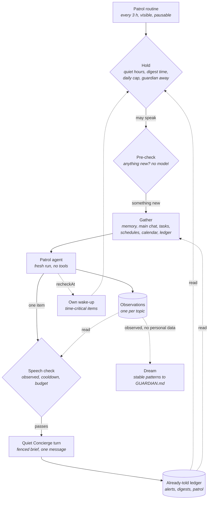

# Concierge Patrol

How the guardian's Concierge looks over what Rome holds for them every few hours and, when one thing is worth it, tells them in one message. Silence is the default. Why the patrol reads nothing itself and why code, not the model, decides when it may speak is in the [ADR](../adrs/a-patrol-that-reads-nothing-itself.md). How alerts and the digest reach the Concierge is in [Concierge following](concierge-following.md).

## Flow

Solid lines are one run. Dashed lines are what a run reads or sets for a later one.

## Invariants

### Trigger

- **One patrol routine serves the guardian.** It fires `core:concierge_patrol` every `CONCIERGE_PATROL_INTERVAL_HOURS` hours, three by default, at 45 minutes past the hour in the guardian's zone. It shows in the routine list like the digest's routines and works for no chat, so no task list shows it.
- **The guardian's pause is final.** Boot keeps the routine's trigger in step with the interval and never turns it back on. A routine the guardian deleted comes back paused. A paused patrol also skips the wake-ups it set itself.
- **The patrol serves only the guardian.** A dashboard admin's Concierge has no patrol.

### Hold

- **The patrol holds before it reads anything** in four cases:
  - inside quiet hours: the guardian's own, or 22:00 to 08:00 when they set none.
  - within 30 minutes of a digest time, before or after it.
  - once three proactive messages were told in the last 24 hours.
  - while the guardian is away: it runs every other fire after a day without a message in the main chat, and once a day after three days.
- **A wake-up the patrol set itself skips the rest while the guardian is away.** Quiet hours, digest times and the cap still hold it. The patrol sets one with `recheckAt`, for an item that needs a look before the next run, such as 30 minutes before a meeting that needs preparation.

### Pre-check

- **A run reads further only when something came in since the last run that went past the pre-check.** The signals are the guardian's messages in the main chat, a task that changed or ended, a wait on the guardian that reached two days, a change to the memory notes the patrol reads, a calendar event that came within the next day, an observation whose due time came within the next day, and the patrol's own wake-up. Code counts them, and no model runs.

### Reading

- **The patrol agent holds no tools, no actions, no subagents and no servers.** Code gathers what it reads into its prompt, so read-only is the tool set's to keep, never the prompt's. A run whose agent definition holds anything is refused before it starts.
- **Each run is a fresh agent session on the Concierge's medium tier,** recorded in the one "Concierge patrol" session, as triage's runs are. It is in no chat and in no task list. The session serves the guardian's main chat, so it takes that chat's owner and privacy: its records hold their personal data.
- **The patrol reads in three tiers.** Follow events, through the ledger, are for understanding only, and a task that a topic chat started is named only by its title. Memory notes, the main chat, tasks and schedules are speakable. The calendar is speakable only with its source named, and the brief marks it so. Health and location are not read.
- **Code reads the calendar for the guardian outside any turn,** and the patrol speaks only in the guardian's main chat, which is private ([audience](../domains/participation.md#audience)).
- **Everything the patrol agent reads is data.** Its prompt says so, and text inside the data never changes what it may do, since it can do nothing.

### Observations

- **The patrol keeps one observation per topic,** with its kind, its source, whether Rome holds the fact or the patrol drew it, a confidence, a status, an expiry and the history of each time it was told and what came of it.
- **An observation holds a pointer, never the content of personal data.** Code replaces a calendar event's title or place in its summary, and the patrol reads the calendar again on every run.
- **A tell is adopted when the guardian writes in the main chat within six hours, and ignored when they do not.** Dream reads the observed ones from no personal-data source, and keeps only stable patterns in `GUARDIAN.md`.

### Speaking

- **Code decides whether the patrol may say what it chose.** The item must be an open observation the patrol holds, observed rather than inferred, with a confidence of at least 0.6, from a speakable source, with a message left today. A topic told is not told again for three days, a topic ignored twice not until it changes, and a muted one not at all. A topic changes when its due time comes within a day since it was told, or its task moved on.
- **The Concierge gets one brief and says one thing.** The brief holds the line, the topic, its kind and source, the length cap, and a task the Concierge may offer with a Start button, inside a fence marked untrusted. The Concierge tells it in one `say` in its own words, or as one question card when a task is offered, and starts that task only when the guardian taps Start. The patrol starts no task.
- **The speaking turn is the Concierge's own.** It is quiet, its input stays in its trace under "Concierge patrol", it carries no source label, and it pushes at the level of an alert.

### Volume

- **At most three proactive messages reach the guardian in 24 hours,** counted across alerts, digests and the patrol from the messages each turn actually said. Only the patrol is held by the cap: alerts and digests keep their own rules.
- **One already-told ledger is written by every alert, digest and patrol turn that said something.** The patrol reads its last three days before it speaks. A turn that said nothing writes nothing.
