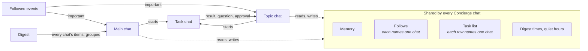

# Concierge

How one Concierge talks with its owner in several [Concierge chats](../domains/chats.md#concierge-chat), hands work to [task chats](../domains/chats.md#task-chat), and sends each result, alert and digest to the chat that should hear it. What the Concierge follows, and how an event reaches it, is in [Concierge following](concierge-following.md). Why there is one Concierge with several chats is in the [ADR](../adrs/one-concierge-with-several-chats.md).

## Flow

Solid lines carry something said to the Concierge or by it. Dashed lines are what every chat reads and writes in common. A task chat started from the main chat reports to the main chat the same way.

## Invariants

### One Concierge, many chats

- **Every Concierge chat is the same Concierge.** Memory, follows, the task list, digest times and quiet hours exist once, and any chat reads and changes them. Nothing about them is kept per chat except the chat each follow and each task row reports to.
- **Each Concierge chat has its own transcript and its own agent session.** What is said in one chat is never in another chat's context. The Concierge reads another of its owner's Concierge chats only through its chat-reading tool, when a question needs it.
- **A rule written for "the Concierge chat" holds in every Concierge chat,** unless it names the main chat. No path checks for the main chat's id to decide behaviour another Concierge chat should share, such as quota failover or the model a resumed session restores.
- **Every Concierge turn's input opens with the chat it runs in:** its id, its name, and whether it is the main chat. It rides each turn, never the session's starting setup, so a rename reaches a running session.

### Each thing reports to one chat

- **A follow reports to one Concierge chat.** A new follow reports to the chat that asked for it. It moves only when a change names another chat, so following the same thing from a second chat answers where it reports and leaves it there.
- **A task row reports to the Concierge chat it was written in.** Its task chat's results, questions and approvals go there as task events, and the panel's buttons for the row send there.
- **Something that reports to a chat that is archived or gone goes to the main chat.** No alert, task event or result waits on a chat the guardian closed.
- **One delivery is one Concierge turn per chat.** A batch of important items or task events that spans chats becomes one turn in each, and each turn counts against the hourly cap of important turns.
- **The digest goes to the main chat only,** with every chat's items grouped under the chat they report to, so an item in a topic chat the guardian does not open is still read.

### The main chat stays

- **Each owner has exactly one main chat, and it is never archived or deleted.** The dashboard refuses both.
- **Archiving or deleting a topic chat moves its follows, its unfinished task rows and the events still owed to it to the main chat,** and the Concierge says so there. Restoring the chat moves nothing back.
- **A topic chat starts on the model the main chat uses,** and keeps its own selection after that.

### Owners

- **Only a chat records its owner.** Follows, task rows and kept events reach their owner through the chat they report to, and a chat with no owner is the guardian's. Today the guardian is the only owner of Concierge chats.
