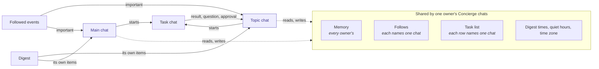

# Concierge

How each person's Concierge talks with them in several [Concierge chats](../domains/chats.md#concierge-chat), hands work to [task chats](../domains/chats.md#task-chat), and sends each result, alert and digest to the chat that should hear it. What the Concierge follows, and how an event reaches it, is in [Concierge following](concierge-following.md). Why there is one Concierge with several chats is in the [ADR](../adrs/one-concierge-with-several-chats.md), and why each person has their own in [a Concierge for each person](../adrs/a-concierge-for-each-person.md).

## Flow

Solid lines carry something said to the Concierge or by it. Dashed lines are what every chat reads and writes in common. A task chat started from the main chat reports to the main chat the same way.

## Invariants

### One Concierge, many chats

- **Every Concierge chat of one owner is the same Concierge.** Follows, the task list, digest times, quiet hours and time zone exist once per owner, and any of that owner's chats reads and changes them. Nothing about them is kept per chat except the chat each follow and each task row reports to. Memory exists once for every owner.
- **Each Concierge chat has its own transcript and its own agent session.** What is said in one chat is never in another chat's context. The Concierge reads another of its owner's Concierge chats only through its chat-reading tool, when a question needs it.
- **A rule written for "the Concierge chat" holds in every Concierge chat,** unless it names the main chat. No path checks for the main chat's id to decide behaviour another Concierge chat should share, such as quota failover or the model a resumed session restores.
- **A Concierge chat's session carries what was agreed across a renewal.** When its setup changes, or a turn ends with its context past the limit, the retired session writes a [handoff](../concepts/sessions.md#handoff) for the next one, and the open tasks come from the task list, not from the handoff.
- **Every Concierge turn's input opens with the chat it runs in:** its id, its name, and whether it is the main chat. It rides the turns, never the session's starting setup, so a rename reaches a running session. A thread reads it, the person it serves and the open workspace again only when one changed since its last input that returned, in full on the first input of a new thread, and again after the provider compacted the thread. A workspace that closed is said once, as an empty block.

### Each thing reports to one chat

- **A follow reports to one Concierge chat.** A new follow reports to the chat that asked for it. It moves only when a change names another chat, so following the same thing from a second chat answers where it reports and leaves it there.
- **A task row reports to the Concierge chat it was written in.** Its task chat's results, questions and approvals go there as task events, and the panel's buttons for the row send there.
- **A task chat turn is the Concierge's unless the owner typed it.** A turn the Concierge started, or one the owner started by answering the task's own card or approval, is reported at once when it ends. A turn the owner started with a message they typed in the task chat is theirs, and the Concierge hears of it quietly, a minute later.
- **A Concierge chat's task panel shows that chat's rows only,** the main chat's included. There is no view of every chat's rows. A row moves to the main chat's panel when its chat is archived or deleted.
- **A Concierge turn's chat is decided when it is sent, in one place.** Alerts, digests, task events, recoveries and the wake-ups of `defer` all pass through it, and a chat that is archived or gone resolves to the main chat, so nothing waits on a chat the guardian closed and nothing stored is rewritten when one closes. A chat that never had a turn gets its runtime first, after the same quota check a message makes.
- **One chat's failed delivery never holds back another's.** Each chat's turn is kept owed and tried again on its own.
- **One delivery is one Concierge turn per chat.** A batch of important items or task events that spans chats becomes one turn in each, and each turn counts against the hourly cap of important turns.
- **Each chat gets the digest of its own follows,** as one turn listing only its items. A chat with nothing new gets none, and the main chat gets an empty one when nothing is new anywhere. A chat's items are marked delivered only after its own turn ran to its end. [ADR](../adrs/digest-to-the-chat-its-follow-reports-to.md)

### The main chat stays

- **Each owner has exactly one main chat, and it is never archived or deleted.** The dashboard refuses both.
- **Archiving or deleting a topic chat moves its follows, its unfinished task rows and the events still owed to it to its owner's main chat,** and the Concierge says so there. Finished rows keep their chat. Nothing that was one owner's ever becomes another's. Restoring the chat moves nothing back. An archived topic chat is listed with the other archived chats, where it can be restored.
- **A topic chat starts on the model the main chat uses,** and keeps its own selection after that.
- **A topic chat started without a name is named from its first message, as an ordinary chat is.** One started with a name, and the main chat, keep theirs.

### Owners

- **The guardian and every visitor on the dashboard allow-list each have their own Concierge while it is on.** Each one's main chat is made the first time they open it. App users have none.
- **A Concierge chat, and every task chat it starts, answers as not found to anyone but its owner,** the guardian included, whether read, written, listed, searched or shown on a project dashboard, and whether reached by the chat's id or by the id of one of its turns or messages. A child session of such a chat, a fork or a subagent, is made private to that owner when it is made, so it stays private whether or not it is promoted, and after the chat it came from is gone. An agent's action can neither read nor write a chat its caller may not open. Privacy fails closed: a chat that cannot be found, or a turn that names no chat that exists, is not found to anyone. A child session is saved together with its parent's owner and privacy, in one step, or not at all. Whether a chat is private is read off its own row, the same way on every path. A history read made from one person's chat leaves out every other person's Concierge and task chats.
- **Every Concierge turn's input names the person the chat serves,** right after the chat it runs in. Memory is shared and describes the guardian, so the Concierge never takes what it says as true of a visitor.
- **A visitor dropped from the dashboard allow-list is served nothing:** their events are not triaged or kept, and no alert, digest or task event reaches their chats. Their follows stay, and the next event after they are back on the list is served again.
- **Everything that outlives its chat records its owner:** each follow, task row and kept event, each event waiting in a batch, and each wake-up the Concierge schedules. The owner is set when the thing is made, from the chat it is made in, and never changes. A chat that is archived or gone sends what reports to it to that owner's main chat, never another's. A wake-up whose chat is gone and that records no owner is dropped, not sent to anyone. Rows from before owners were kept are the guardian's.
- **Triage runs once per batch for each owner,** with that owner's follows, what that owner was told recently and that owner's time zone. Two owners who follow the same thing each hear its events, and the subscription at the source stays while anyone follows it.
- **Each person's follows, rules and time zone are read and written only through their own Concierge,** never through the generic settings.
- **An event already queued for an owner stays theirs,** even after they stop following its target, and reaches their own main chat.
- **Quiet hours, the hourly cap of important turns and the digest are each owner's own.** A visitor's digest comes at their times in their own zone, and follows it when it changes. The guardian's follows the guardian's zone, as every floating routine does. One owner's quiet hours never hold another's alerts.
- **A Concierge turn acts only within its owner's Concierge:** the chats, task chats, rows and follows its tools reach are that owner's.
