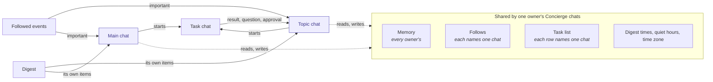

# Concierge

How each person's Concierge talks with them in several [Concierge chats](../domains/chats.md#concierge-chat), hands work to [task chats](../domains/chats.md#task-chat), and sends each result, alert and digest to the chat that should hear it. What the Concierge follows, and how an event reaches it, is in [Concierge following](concierge-following.md). Why there is one Concierge with several chats is in the [ADR](../adrs/one-concierge-with-several-chats.md), and why each person has their own in [a Concierge for each person](../adrs/a-concierge-for-each-person.md).

## Flow

Solid lines carry something said to the Concierge or by it. Dashed lines are what every chat reads and writes in common. A task chat started from the main chat reports to the main chat the same way.

## Invariants

### One Concierge, many chats

- **Every Concierge chat of one owner is the same Concierge.** Follows, the task list, digest times, quiet hours and time zone exist once per owner, and any of that owner's chats reads and changes them. Nothing about them is kept per chat except the chat each follow and each task row reports to. Memory exists once for every owner.
- **Each Concierge chat has its own transcript and its own agent session.** What is said in one chat is never in another chat's context. The Concierge reads another of its owner's Concierge chats only through its chat-reading tool, when a question needs it.
- **A rule written for "the Concierge chat" holds in every Concierge chat,** unless it names the main chat. No path checks for the main chat's id to decide behaviour another Concierge chat should share, such as quota failover or the model a resumed session restores.
- **A Concierge chat's session carries what was agreed across a renewal.** When its setup changes, or a turn ends with its context past the limit, the retired session writes a [handoff](../concepts/sessions.md#handoff) for the next one, and the open tasks come from the task list, not from the handoff.
- **The Concierge hands work to task chats and does only quick lookups itself.** It may search the web for a quick fact, a few searches in a turn, but reaches none of ChatGPT's apps and fetches no page with its shell. Its prompt and tools leave out what only an agent doing the work needs, such as the command line tools, the installed apps, diagrams and `propose_routine`.
- **Every Concierge turn's input opens with the chat it runs in:** its id, its name, and whether it is the main chat. It rides the turns, never the session's starting setup, so a rename reaches a running session. A thread reads it, the person it serves and the open workspace again only when one changed since the last input it is known to have read: one whose turn returned a result, with no compaction the provider reported and no input steered in since. Otherwise, as on a new thread, it reads all of them. A workspace that closed is said once, as an empty block.

### Each thing reports to one chat

- **A follow reports to one Concierge chat.** A new follow reports to the chat that asked for it. It moves only when a change names another chat, so following the same thing from a second chat answers where it reports and leaves it there.
- **A task row reports to the Concierge chat it was written in.** Its task chat's results, questions and approvals go there as task events, and the panel's buttons for the row send there.
- **A task reports with its own conclusion.** Every final answer in a task chat ends with a conclusion section between two HTML comment markers: three to five sentences that stand on their own, with the outcome, the specifics the owner needs such as numbers, names, dates, prices and links, and anything the owner must decide. It leads with the answer and covers every point the request asked for, each option on each point for a comparison, and nothing it did not ask for. A conclusion never sends the owner elsewhere for details, and neither does the Concierge. Code adds that instruction to the system prompt of every session that serves a task chat, however it opens: a first turn, a follow-up, the owner's own message, and a wake-up or approval that resumes an evicted session. The conclusion follows the language of the owner's request as the brief gives it, and the Concierge writes the brief in the owner's language. The instruction is no part of a session's setup, so it renews no session. The task event carries the conclusion whole. The Concierge tells the owner the result in one `say` written from it, a reply to the task's start message, with every link, version, number and id exact. It never retells the rest of the answer. A conclusion that is missing or over 1200 characters is not read as one, and the Concierge reports in its own words. The whole answer goes only in a turn the owner started, on their explicit request: the Concierge reads it with `chat_read` and says it as one long message. The dashboard hides the markers. A final answer may also show an [agent card](../domains/chats.md#agent-card) for a result with a real structure. The task event then lists every card its turn showed, one `card id=` line each, and `card_forward` sends a card by that id, issued again server-side, or its plain-text line where the Concierge chat cannot draw cards. Any card of the Concierge chat's own task chats can go, from any turn, one card per call.
- **A Concierge message carries news.** A result that only confirms or carries out what the owner chose on a card or decided on an approval, such as their pick saved or the file they approved written, has a fixed conclusion that says there is nothing to report, in every language. The Concierge still hears of that turn, as of every task chat turn, and its prompt tells it to send nothing for such a conclusion: Rome drops no turn's end by what it says. The Concierge never restates a card's outcome, acknowledges a request, or announces what it is about to do, and it shows a task card only when the owner asks to see the task.
- **Every task chat turn's end reaches the Concierge, which judges it by what it says.** Each end is told within seconds, whoever started the turn: the Concierge (its message, a scheduled run's brief, or the owner answering the task's own card or approval: `by=concierge`), the owner typing in the task chat (`by=guardian`), or a wake-up the task chat set itself (`by=system`). Rome filters no end by who started it: `by` is a fact for the Concierge, which tells a new result and stays silent on progress, on what it already told, and on what the owner read in the task chat themselves. A scheduled task that reports only when it matters says so in its event, and the Concierge tells only news or a problem. A report turn shows no sign that it runs until the Concierge speaks, since most need no word.
- **A task's question card or approval is forwarded as itself.** The task event names the card it waits on, one `card id=` line, and `card_forward` puts that same card in the Concierge chat: answering it there answers the task chat's card, and both show the one answer and its expiry. Nothing is copied, so nothing needs syncing. The answer reaches the Concierge as the task's next turn. An approval goes the same way, by its approval id. Only the owner's tap on a card decides it, and the Concierge has no way to.
- **A task's status is derived from facts Rome holds, never written by the Concierge.** The task list and the chat header read one derivation, and a change in any fact it reads tells the task list again. A stopped task is ended whatever else holds.
- **`chat_read` shows a running task chat's plan.** While its turn runs, the turn's plan, the one its Plan card shows, comes with its latest messages: at most 8 steps of at most 80 characters each, each with its status, read from the running turn in memory. The Concierge reports the task's progress by it. A turn with no plan adds nothing.
- **A Concierge chat's task panel shows that chat's rows only,** the main chat's included. There is no view of every chat's rows. A row shows on the main chat's panel while its chat is archived or deleted, and the row itself never moves.
- **A Concierge turn's chat is decided when it is sent, in one place.** Alerts, digests, task events, recoveries and the wake-ups of `defer` all pass through it, and a chat that is archived or gone resolves to the main chat, so nothing waits on a chat the guardian closed and nothing stored is rewritten when one closes. A chat that never had a turn gets its runtime first, after the same quota check a message makes. A turn runs in its chat's current session, whichever session asked for it, so a wake-up set in a session since renewed still wakes its chat.
- **A check the Concierge schedules belongs to its chat, and to its task when it names one.** The chat shows it until it wakes, and its owner can cancel it there. The task is later until then, and stopping or archiving the task cancels its checks. A check that waits for an event says what it waits for and has a deadline, and wakes the chat then if the event never came. The Concierge's agent policy asks for both. Another agent's event wait takes neither. A check whose time passed while Rome was down wakes its chat when Rome starts.
- **A task's news is delivered once.** A Concierge turn that ran to its end with it settles it, and the Concierge owes no row write, since Rome keeps the status. A turn that did not run is tried again, and one its owner stopped is not.
- **Only the owner and the Concierge say anything in a Concierge chat.** A send from a routine, an app or another agent, whether as the owner's input or as an agent's message, runs as a quiet system turn whose input stays in the turn's trace with its source, and the chat draws only a line naming that source. The Concierge decides what to say. A task chat's result reaches the Concierge chat only through the task's report, and every task chat is told never to send there itself. Common chats keep such sends as messages.
- **A task's schedule sends its brief into the task's own task chat, never into a Concierge chat,** and wakes no Concierge turn to do it. The run reports as a turn the Concierge started, or, when the task reports only when it matters, as a scheduled run. A task has one schedule, its next run is the task's check, and anything that cancels the task's checks removes it. Recurring work the owner asks of a task chat becomes that task's schedule, which the Concierge sets: a task chat sets up no routine or schedule for it, says the wish to the Concierge outside its conclusion, and keeps only the checks it defers for its own work. [ADR](../adrs/scheduled-tasks.md)
- **News that needs no word wakes no turn.** A scheduled run of a task chat that finished with no question, approval or error goes with the next delivery, or into the next digest, never into a turn of its own.
- **One chat's failed delivery never holds back another's.** Each chat's turn is kept owed and tried again on its own.
- **One delivery is one Concierge turn per chat.** A batch of important items or task events that spans chats becomes one turn in each, and each turn counts against the hourly cap of important turns.
- **Each chat gets the digest of its own follows,** as one turn listing only its items. A chat with nothing new gets none, and the main chat gets an empty one when nothing is new anywhere. A chat's items are marked delivered only after its own turn ran to its end. [ADR](../adrs/digest-to-the-chat-its-follow-reports-to.md)

### The main chat stays

- **Each owner has exactly one main chat, and it is never archived or deleted.** The dashboard refuses both.
- **Archiving or deleting a topic chat moves its follows and the events still owed to it to its owner's main chat,** and the Concierge says so there. Its task rows stay its own and are read as the main chat's while it is archived or gone, which is the one way a row changes chat. Nothing that was one owner's ever becomes another's. Restoring the chat moves back the follows its archive moved that still report to the main chat, when its owner chooses so, and its rows read as its own again. A follow its owner ended or moved since is not moved back. Archiving or deleting a topic chat can instead end its follows and stop its open tasks when its owner chooses so. Whatever fails to end still moves, and an archive or delete that ends everything leaves the main chat no notice. An archived topic chat is listed with the other archived chats, where it can be restored.
- **A Concierge chat runs on the strongest model of its provider.** A new main chat starts on the [strong](../domains/agents.md#model-strength) model of the owner's Claude login, else of Codex. A topic chat starts on the model the main chat uses, and keeps its own selection after that. An automatic move to the other provider lands on that provider's strong model. A change of Rome's default moves a chat only when Rome chose its model, never when its owner did. Every turn of a Concierge chat runs at the Concierge's own reasoning effort, whatever the composer sends.
- **Each task chat runs at the strength and effort its work needs.** The Concierge picks fast and low effort for a lookup, fetching and summarizing, or a reminder, and strong and high for research, analysis, a plan or code. The task chat stores both, so its brief, follow-ups and scheduled runs all run at them.
- **A topic chat started without a name is named from its first message, as an ordinary chat is.** One started with a name, and the main chat, keep theirs.

### Owners

- **The guardian and every dashboard admin each have their own Concierge while it is on.** Each one's main chat is made the first time they open it. App users have none.
- **The guardian and every dashboard admin open any Concierge chat and any task chat,** by the chat's id or by the id of one of its turns or messages. The chat list, search and a project dashboard show a person their own. An agent's action can neither read nor write another person's. A turn that names no chat that exists is not found. A child session of such a chat, a fork or a subagent, is saved together with its parent's owner, in one step, or not at all, so it stays that owner's whether or not it is promoted, and after the chat it came from is gone. A history read made from one person's chat leaves out every other person's Concierge and task chats.
- **Every Concierge turn's input names the person the chat serves,** right after the chat it runs in. Memory is shared and describes the guardian, so the Concierge never takes what it says as true of a visitor.
- **A removed member's Concierge keeps its follows.** What they follow goes on being triaged and delivered to their chats, which are closed to them, because nothing inside asks about [access](./access-control.md#entry). Rome Cloud refuses a push to them once it holds the new visitor list ([notification delivery](./notification-delivery.md)). This is a known limitation.
- **Everything that outlives its chat records its owner:** each follow, task row and kept event, each event waiting in a batch, and each wake-up the Concierge schedules. The owner is set when the thing is made, from the chat it is made in, and never changes. A chat that is archived or gone sends what reports to it to that owner's main chat, never another's. A wake-up whose chat is gone and that records no owner is dropped, not sent to anyone. Rows from before owners were kept are the guardian's.
- **Triage runs once per batch for each owner,** with that owner's follows, what that owner was told recently and that owner's time zone. Two owners who follow the same thing each hear its events, and the subscription at the source stays while anyone follows it.
- **Each person's follows, rules and time zone are read and written only through their own Concierge,** never through the generic settings.
- **An event already queued for an owner stays theirs,** even after they stop following its target, and reaches their own main chat.
- **Quiet hours, the hourly cap of important turns and the digest are each owner's own.** A visitor's digest comes at their times in their own zone, and follows it when it changes. The guardian's follows the guardian's zone, as every floating routine does. One owner's quiet hours never hold another's alerts.
- **A Concierge turn acts only within its owner's Concierge:** the chats, task chats, rows and follows its tools reach are that owner's.

### On a connection

- **A newly connected Slack or Discord app account answers as the guardian's Concierge.** Connecting Rome's Slack app links the Concierge to its account, since the kind declares it, and anyone who writes there reaches the guardian's Concierge, never a visitor's. Another kind's account starts with no agent, and the guardian may link the Concierge to it by hand. A sender who is not the guardian passes the same bond-level and outgoing-message checks as with any agent on an account, and their turn is shared. ([ADR](../adrs/channels-and-connectors-are-one-connection.md#amendment-2026-11-20-a-newly-connected-slack-app-account-starts-with-the-concierge))
- **On a connection the Concierge speaks as on the dashboard, and only where its messages go differs.** A chat on a connection is not a Concierge chat, but the Concierge there runs the same way: it speaks only through `say`, its own text stays private, and it ends each turn with `done`. Its message goes out as the inbox sends an agent's reply: past the account's send gate, and Envoy where the gate asks, as for a reply to anyone but the guardian, then to the platform through the chat's speaker, which records it in the chat and can quote the message it answers. A message the gate holds or refuses is not sent, and `say` tells the Concierge so. `say` refuses `private` there, since others may read the chat and no lock screen hides a message, and a message there rings no phone. A turn whose last text is not `done` gets one reminder turn there too. The inbox only wakes the Concierge: a private turn's result reaches it without words, so it sends nothing of its own. The typing indicator follows the dashboard's dots' signal, a `say` being written, at the session's events, so every turn a person's message starts shows it, whichever way it runs ([channels](./channels.md)). The session gets none of the tools or actions that act in, or for the owner of, a Concierge chat: it neither starts nor changes a follow, shows no card and asks no question card. It keeps `say`, `react` and the tools for tasks (below). It schedules no later wake-up there either, since a reply a wake-up sends skips the checks the message that asked for it passed. A renewed session there starts with no handoff, since the handoff's replay of the chat names every sender the guardian. It still starts fresh when its setup changes, as on an upgrade that changes its prompt or tools, so a bot session never keeps instructions it has outgrown, and what it knew of the chat goes with it. One answer about the place decides the tools, the actions and the instructions. It gets its own instructions there in place of the dashboard ones, which show cards, run follows and set reminders: told about those, a model calls them anyway. They tell it never to say a secret, since nothing there is private, and to send the guardian to the dashboard for a follow or a secret. For the chat's earlier messages, which a restart or a renewal can leave out of its context, it reads the chat through the connection with `system:fetch_channel_history` instead. A turn others read, such as a visitor's or a group's, reads only the chat it is in that way, so nobody but the guardian can have it read another chat ([participation](../domains/participation.md#audience)). Where the connection reads no history, which is every bot connection today until one gains a read, the call fails and it asks the person to say it again.
- **A chat on a connection shows a message's status as a reaction.** A turn the guardian's message starts there takes that message as on the dashboard, and its working tool calls show it working by the same rule (`MessageStatusTracker`, fed at the session's events in the agent session bridge). Its end settles it the same way, and a message it left without any sign gets ✅, sent to the platform. The platform draws no status of its own, so the account's own reaction shows it: 👀 while working and ⚠️ once failed, taken off again once the message has no status (`concierge/connection-status.ts`, `TalkReactions.remove`). A message that showed working takes no reaction there either.
- **A chat on a connection takes a reaction.** On a connection the Concierge keeps `react` too: one emoji on the guardian's message of the turn, sent to the platform through the account (`TalkReactions`), as Rome's Discord and Slack apps offer. Only the guardian's turn may react, a reaction there cannot be taken back, and no message status follows it.
- **A chat on a connection can start a task, and the task reports there.** The Concierge keeps `chat_start`, `chat_send`, `chat_read`, `chat_stop` and `chat_list` on a connection. Only a turn the guardian started, or a task's report, which no one sent, may use them. Anyone else's is refused. A task started there names that chat as the Concierge chat it reports to (`task_chats.concierge_chat_id` holds the chat's `rome_sessions` id), so its `<task_events>` run as a system turn in that chat's session, and what it says goes to the same DM, channel or thread. A chat that is gone sends them to the guardian's main chat, as for any chat. Its link is the dashboard's address, since a chip shows only on the dashboard. A question is asked there in words and its answer passed on with `chat_send`. An approval is only ever given on the dashboard. The main chat's task list also lists the tasks started from chats on connections.
