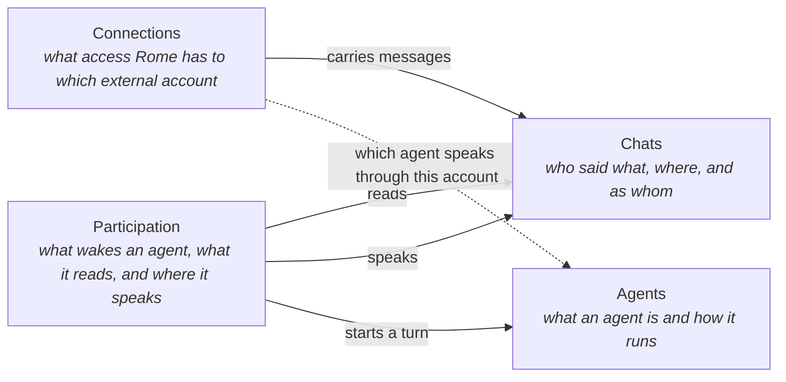

# docs/domains/

The language Rome's code, docs and dashboard share for chats, accounts, agents and connections, written with the guardian as the domain expert. It follows Domain-Driven Design: the language is split into contexts, each answering one question, and inside a context every word has one meaning. The code carries the same words, so a reader of the code reads the model.

This folder is the source of truth for what these words mean. Other docs link here instead of defining them again, and [`concepts/`](../concepts/index.md) holds the terms that lie outside these contexts.

## Contexts

| Context | Its question | File |
|---|---|---|
| **Chats** | Who said what, where, and as whom | [chats.md](chats.md) |
| **Connections** | What access Rome has to which external account | [connections.md](connections.md) |
| **Participation** | When an agent takes part in a chat, what wakes it, what it reads, and where it speaks | [participation.md](participation.md) |
| **Agents** | What an agent is and how it runs | [agents.md](agents.md) |

Connections carry messages between chats and Rome. Participation sits between Chats and Agents: it reads the chat's record, speaks back into it, and starts an agent's turn. The dashed line is the link the guardian sets after connecting an account, as a separate step: which agent speaks through it. An account may have none. Chats follows the definitions of Connections and Agents and changes neither. Connections and Agents do not depend on each other.

## How to read a context file

Each word has a heading, its meaning in one or two sentences, and the rules that go with it: identity, lifetime, operations, and what must stay true. A context file ends with the alternatives decided against, each with the force that killed it, so a settled question is not argued again.

## How to change the language

- A new word enters its context file before it enters code, UI copy or a doc. If it fits no context, it is not one of these words and belongs in [`concepts/`](../concepts/index.md).
- A change to a rule lands in the same PR as the code that follows it.
- One meaning per word within a context. A word that needs two meanings is two words.
- The rules for writing here are in [`authoring/domains.md`](../authoring/domains.md).

## Where the code stands

The language is the model. The code holds most of it and owes the rest. A reader of `main` can rely on:

- An account that takes an agent exists only while connected and is never reclaimed by the next connection. Email and WhatsApp accounts, which take no agent, keep their record across a reconnect.
- Rome listens to an account that takes an agent only while one is linked. An account that takes no agent is always listened to.
- A newly connected account starts with no agent. Rome never links one on its own, and the guardian links it afterwards.
- An agent can be linked to any number of accounts, several on one platform included, and an account has one agent in storage.
- Feishu and Lark are two platforms.
- The dashboard and docs say account, agent, connect, disconnect, link, switch and unlink.

Diffs still owed to the model, each a change of its own:

- Chat replaces conversation in the dashboard, the docs and the code.
- The per-chat agent override is removed, with a migration.
- The own-account and delegate kinds of link are stored and shown.
- One group is one chat across all of Rome's accounts in it.
- A Feishu person is one account across all of Rome's Feishu accounts, by the tenant-wide id.
- The participants of a chat are the platform's member list.
- Adapters deliver every message, and the reply rule is applied after delivery.
- A thread's messages are the parent chat's, marked by thread.
- A disconnected account's record is deleted, with the chats it alone was in. A chat another of Rome's accounts is in keeps its whole history.
- The reply rule takes the value "when it is needed", backed by the lightweight check.
- A woken agent gets the recent messages of its place as its default view, and a tool to read more of the chat.
- A message to a chat other than the one the agent was woken in waits on an approval card.
