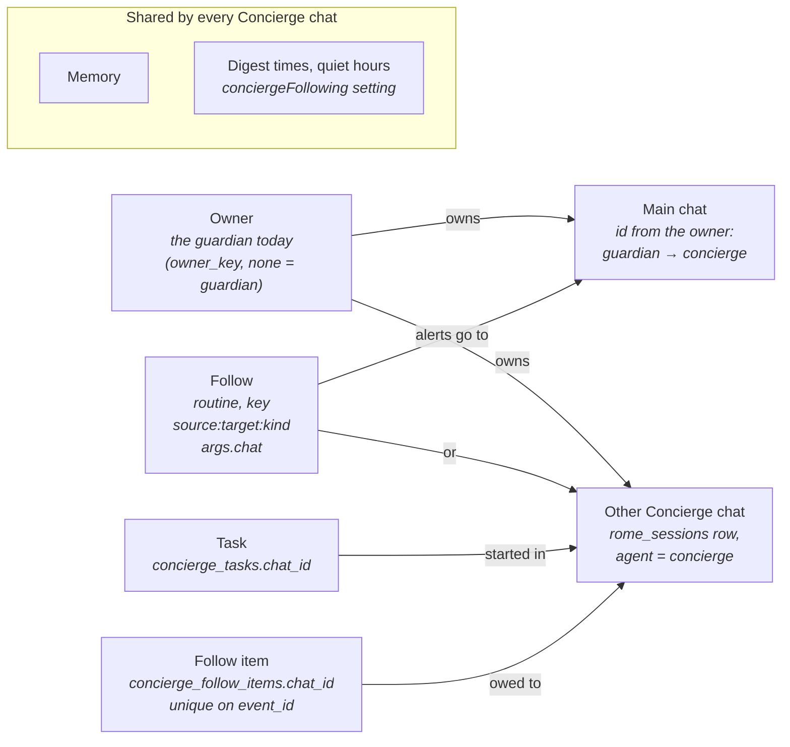
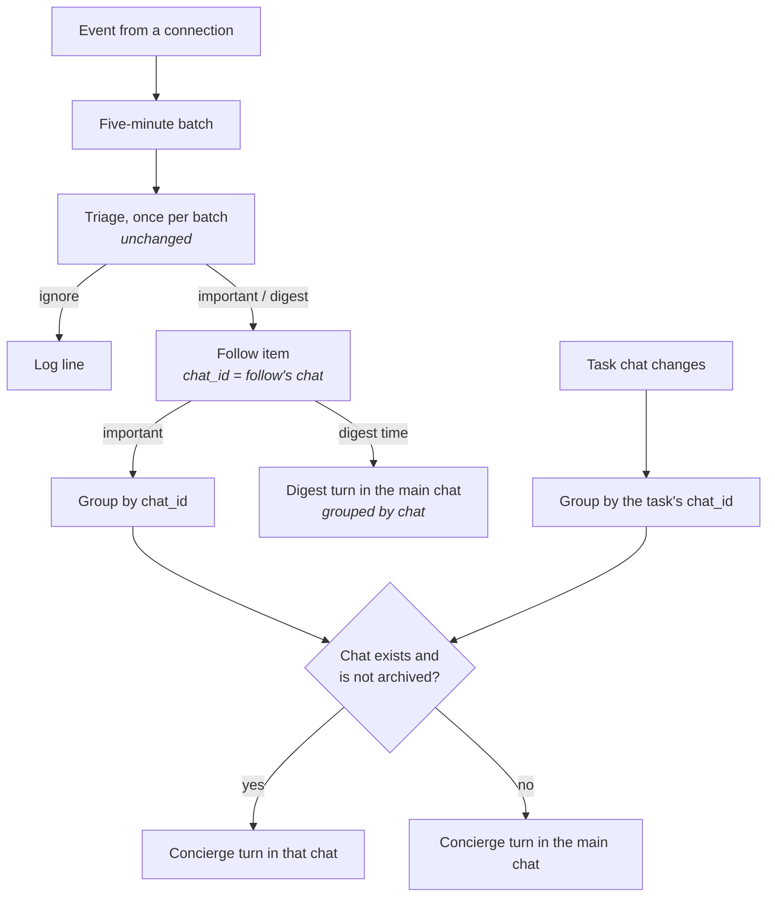

# Several Concierge chats: design

Working file for the lead and the worker. Not committed. The durable parts land in the implementation PR: the word in `docs/domains/chats.md`, the invariants in a new `docs/architecture/concierge.md`, and the ADR `docs/adrs/one-concierge-with-several-chats.md`. The rest becomes the PR description.

Status: approved by the guardian on 2026-11-05.

The model follows Muse: **one Concierge with a main chat and other chats.** Memory, follows, tasks, digest times and quiet hours are shared. Each chat has only its own transcript, its own agent session, and the follows whose alerts go to it. Words (entries in `docs/domains/chats.md`): a **Concierge chat** is a **main chat** or a **topic chat**. The main chat is the one each owner always has. A topic chat is one the owner starts for a topic, beside the main chat. A **task chat** is the chat the Concierge starts to hand work to another agent, as today; it belongs to the Concierge chat that started it.

## What the guardian sees

- Under Concierge in the sidebar: the main chat, then the topic chats. A "+" starts one, and so does asking in any Concierge chat ("start a chat for my calendar"). The Concierge never starts one on its own.
- A topic chat can be renamed, archived and deleted. The main chat cannot be archived or deleted.
- A new topic chat starts on the model the main chat uses.
- Chats do not share transcripts. The Concierge reads another Concierge chat of the same owner when a question needs it ("what did we last say in Calendar?"), never on every turn.
- A follow's alerts go to the chat it was made in. "Send calendar alerts here from now on" moves them to the current chat.
- One thing is followed once. Following it again from another chat gets the question "This is already followed in Calendar. Move its alerts here?"
- The follow list stays one list, readable and editable from any chat, and shows each follow's chat. The task panel and its pill show only the open chat's tasks, in every chat including main; there is no view of all chats' tasks.
- A task chat's result comes back to the Concierge chat that started it.
- The digest goes to the main chat only, grouped by chat, so nothing said in another chat is missed.

## Data and ownership

- **Concierge chat.** A dashboard chat whose agent is the Concierge. No new column: its name is the chat's `name`, and its owner is the chat's `owner_key`.
- **Main chat.** No "main" column. The owner decides the main chat's id. The guardian's is today's `concierge`. Code gets it from one "main chat of owner" function and checks "is a Concierge chat" by the chat's agent, so nothing compares against `CONCIERGE_CHAT_ID` directly.
- **Follow.** The routine's args gain `chat`, the chat its alerts go to. A follow with no `chat` goes to the main chat. The routine key stays `concierge-follow:<source>:<target>:<kind>`, so one thing has one follow. Moving it rewrites `chat`.
- **Task.** `concierge_tasks` gains a nullable `chat_id`, the chat the task came from. Null means the main chat.
- **Follow item.** `concierge_follow_items` gains a nullable `chat_id`, copied from the follow when triage stores the item. The unique index stays on `event_id`.
- **Settings.** `conciergeFollowing` is unchanged.
- **Migration.** Two nullable columns. No backfill.

**Room for visitors.** The owner lives only on the chat. A follow, a task and an item each reach their owner through their `chat`, and no owner means the guardian, as for chats today. When visitors get a Concierge, a visitor's follow keys gain an owner prefix (no prefix = guardian, so no migration). The one change that needs a migration then is the follow items' unique index, from `event_id` to owner plus event.

## Delivery

- Triage still runs once per batch.
- Important items are grouped by their follow's chat, with one Concierge turn per chat.
- An item whose chat is gone or archived goes to the main chat.
- Task events (`<task_events>`) are grouped by each task's chat the same way.
- The hourly cap and quiet hours stay one set for everything. The cap counts Concierge turns, so a batch that reaches three chats counts three. It stays at 12 per hour. With one chat the cap was almost never reached (one batch per five minutes is at most 12 an hour); with several chats it can be.
- Quota failover works on every Concierge chat, not only the fixed one. Update the ADR `concierge-quota-failover`, which says "Only the fixed Concierge chat qualifies".
- Each Concierge turn's input says which chat it runs in: the chat's name, and whether it is the main chat. This goes in the turn input, not the session's starting setup, because a rename does not reach a running session (rome-os/rome#1739).

## Digest

- At the digest times (09:00 and 18:00 in the guardian's time zone by default), one digest goes to the main chat.
- Items are grouped by chat. Each group names its chat and carries its chat card. A chat with nothing owed is left out.
- An item already told live gets one short line, as today.

## Sidebar

- Task chats show under the Concierge chat that started them.
- Each topic chat shows its own unread state, like any chat. An alert in a topic chat adds nothing to the main chat until the digest.

## Archive and delete

- The main chat cannot be archived or deleted.
- Archiving or deleting a topic chat moves its follows' `chat` and its unfinished tasks' `chat_id` to the main chat, then the Concierge says so in the main chat ("Calendar was archived. Its 3 follows now report here.").
- Restoring an archived chat does not move follows back. The guardian asks for that ("send them here").

## One agent session per chat, and rome-os/rome#1739

- Each Concierge chat has its own agent session. The session key already comes from the chat id. Memory, follows and tasks live outside the session, so chats share no context through it.
- rome-os/rome#1739: a long-lived chat keeps one session, so a rename, new tools and new instructions never reach it. With several chats, every Concierge chat has this problem.
- This design does not fix #1739. It makes sure the fix will reach every chat:
  1. Every special case for the one fixed chat (quota failover, the session-pin exception in `agent-session.ts`) applies to all Concierge chats.
  2. What changes during a session (which chat, its name) goes in each turn's input.
- A new Concierge chat starts a new session, so it gets the latest setup.

## One PR

The guardian wants one PR. It carries:

- core: "is a Concierge chat" and "main chat of owner"; start (on the main chat's model), rename, archive and delete, plus a Concierge tool to start a chat; `chat_list` and `chat_read` reaching the owner's Concierge chats; `chat` in follow args, moving a follow in `follow` and `following_configure`, each follow's chat in `following_list`; `concierge_tasks.chat_id` and `concierge_follow_items.chat_id`; important items and task events delivered per chat, with the main chat as the fallback; the digest grouped by chat; archive and delete moving follows and tasks to the main chat and saying so there; quota failover on every Concierge chat; the current chat in each turn's input.
- web: no hard-coded chat id (about 10 files); the sidebar lists Concierge chats with start, rename, archive, delete and switch; the follow list shows each follow's chat; the task panel and its pill show only the open chat's tasks.
- docs:
  - The Concierge chat, main chat, topic chat and task chat entries in `docs/domains/chats.md` and the README line are written on branch `claude/concierge-multi-chat-3e7be3`. Take them as they are, and remove the README's "owed" line once the code lands.
  - The ADR `docs/adrs/one-concierge-with-several-chats.md`, on the same branch.
  - A new `docs/architecture/concierge.md` (the guardian asked for it): the Concierge's chats, tasks and task chats, one session per chat, quota failover, and the invariants above under Delivery, Digest, and Archive and delete. Add it to `docs/architecture/index.md`.
  - `docs/architecture/concierge-following.md`: one line saying alerts go to the follow's chat, linking to `concierge.md`. It is 1,146 words, over the family's 1,000-word cap, so trim it in the same PR. Candidates: the retry timings and try counts (mechanism, not contract), the Composio delivery-id detail, the #1658 note (planned behavior belongs in the issue), and "a Concierge thread keeps the tools it started with" (now rome-os/rome#1739).
  - Update the ADR `concierge-quota-failover`: every Concierge chat qualifies, not only the fixed one.
  - Run `pnpm lint:prose` on every changed doc.

## Reading another chat

- The Concierge's chat-reading tools (`chat_list`, `chat_read`) reach task chats today. Widen them to the owner's other Concierge chats, and say in the prompt: read one only when the question needs it.
- Nothing is read automatically, and no transcript is copied between chats.

## Not in v1

- A visitor's own Concierge (only the room above).
- One follow sending to several chats.
- Muting one chat.
- Digest times or quiet hours per chat.
- The Concierge starting a chat on its own.
- Merging the Concierge into the dashboard's Chat.
